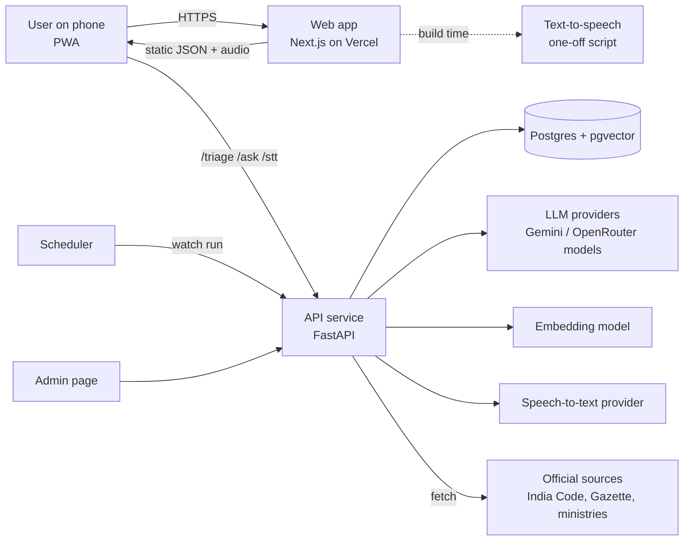
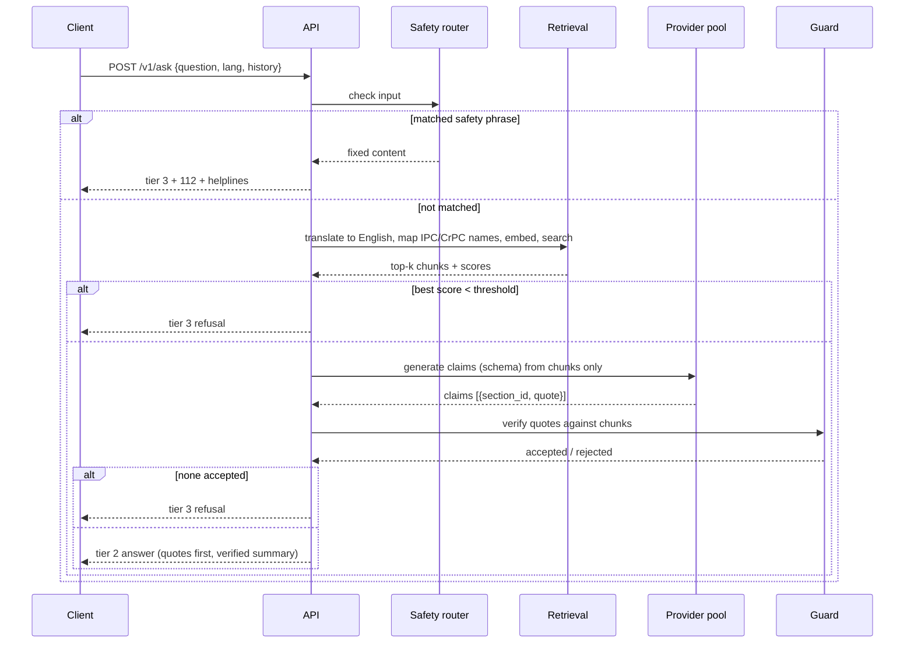
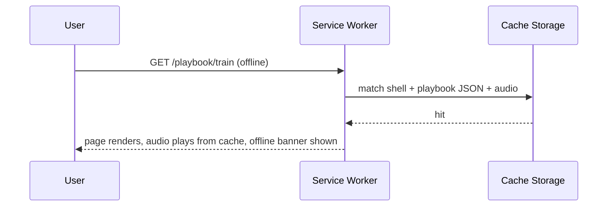
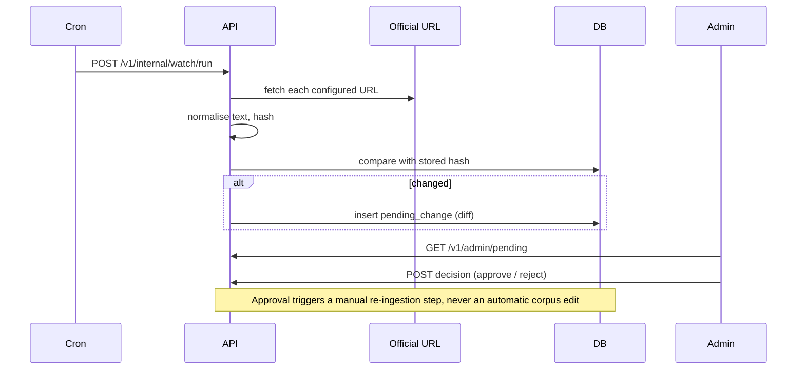

# 05 — Architecture and API Design

**Version:** 0.1 · **Date:** 2026-10-09
All JSON below is a **contract example**. Values in `<angle brackets>` or marked `EXAMPLE` are illustrative and must never be copied into the product as legal content.

---

## 1. System context



## 2. Containers and responsibilities

| Container | Tech | Responsibility | Scales by |
|---|---|---|---|
| Web app | Next.js, Service Worker | UI, i18n, offline cache, audio player, mic recorder | CDN |
| API service | Python FastAPI (one container) | Triage, Ask, STT proxy, guard, watcher, admin | One always-on instance (enough for demo) |
| Database | Managed Postgres + pgvector | Corpus chunks, embeddings, pending changes, eval data | Managed |
| Static content | Repo → CDN | Playbooks, helplines, strings, audio | CDN |
| Providers | External APIs | LLM, embeddings, STT | Provider quota |

## 3. Key sequences

### 3.1 Tier-2 question (online)



### 3.2 Opening a playbook offline



### 3.3 Watcher (P2)



## 4. API specification (v1)

### 4.1 Conventions
- Base path `/v1`. JSON UTF-8. Language codes: `en`, `hi`, `mr`.
- Every response carries `X-Request-Id`. Errors share one shape.
- **No endpoint accepts or returns user identifiers.** No cookies.
- CORS: allow-list of the web origin(s) only.
- Rate limit: per IP per minute (config `RATE_LIMIT_PER_MIN`); `429` with `Retry-After`.
- Input limits: question ≤ 500 characters; audio ≤ 30 seconds / ≤ 2 MB.

**Error shape**
```json
{
  "error": {
    "code": "RATE_LIMITED",
    "message": "Too many requests. Please wait a moment.",
    "request_id": "<id>"
  }
}
```
Codes: `BAD_REQUEST`, `UNSUPPORTED_LANGUAGE`, `RATE_LIMITED`, `PROVIDER_UNAVAILABLE`, `UNAUTHORIZED` (admin), `NOT_FOUND`, `INTERNAL`.

### 4.2 Endpoint summary

| Method | Path | Feature | Auth | Purpose |
|---|---|---|---|---|
| GET | `/health` | — | none | Liveness + DB check |
| GET | `/v1/content/version` | F10 | none | Content version/date for cache refresh |
| GET | `/v1/playbooks` | F04 | none | List playbooks (id, title, icon, reviewed) |
| GET | `/v1/playbooks/{id}` | F04 | none | One playbook in a language |
| GET | `/v1/helplines` | F14 | none | Helplines list |
| POST | `/v1/triage` | F03 | none | Classify text/voice transcript into a situation |
| POST | `/v1/ask` | F06/F07 | none | Grounded Q&A |
| POST | `/v1/stt` | F08 | none | Speech to text |
| GET | `/v1/sources/{section_id}` | F06 | none | Full chunk text + source info |
| GET | `/v1/admin/pending` | F12 | secret | List pending changes |
| POST | `/v1/admin/pending/{id}/decision` | F12 | secret | Approve or reject |
| POST | `/v1/internal/watch/run` | F12 | secret | Trigger watcher run |

### 4.3 `POST /v1/triage`

Request
```json
{
  "text": "<user words or transcript>",
  "lang": "hi",
  "answers": [{"question_id": "q1", "choice_id": "stranger"}]
}
```
Response (classified)
```json
{
  "request_id": "<id>",
  "safety": null,
  "situation_id": "<one of the six ids or null>",
  "confidence": 0.0,
  "next_question": null,
  "playbook_url": "/playbook/<id>"
}
```
Response (safety router matched; no model used)
```json
{
  "request_id": "<id>",
  "safety": {
    "kind": "immediate_danger",
    "content_id": "safety.immediate_danger",
    "helplines": ["112"]
  },
  "situation_id": null
}
```
`situation_id = null` with `confidence` below threshold means "show the grid".

### 4.4 `POST /v1/ask`

Request
```json
{
  "question": "<user text>",
  "lang": "mr",
  "history": [
    {"role": "user", "text": "<earlier question>"},
    {"role": "assistant", "text": "<earlier summary text only>"}
  ]
}
```
Response — Tier 2 (EXAMPLE shape)
```json
{
  "request_id": "<id>",
  "tier": 2,
  "badge": "from_the_law",
  "lang": "mr",
  "answer": {
    "quotes": [
      {
        "section_id": "<ACT>:<SECTION>",
        "act": "<official Act title and year>",
        "section": "<number>",
        "heading": "<official heading>",
        "quote": "<exact text from the chunk>",
        "plain_line": "<one-line explanation in the user's language>",
        "source_url": "<official URL>",
        "verified_on": "<YYYY-MM-DD>"
      }
    ],
    "summary": [
      {"text": "<sentence built only from verified quotes>", "quote_refs": [0]}
    ],
    "related_playbook_id": "<id or null>",
    "legacy_note": "<mapping note if the user used an old section name, else null>"
  },
  "helplines": ["112"],
  "meta": {
    "provider": "<model id>",
    "latency_ms": 0,
    "best_score": 0.0,
    "claims_accepted": 0,
    "claims_rejected": 0
  }
}
```
Response — Tier 3 refusal
```json
{
  "request_id": "<id>",
  "tier": 3,
  "badge": "not_confirmed",
  "lang": "hi",
  "answer": null,
  "refusal": {
    "reason": "below_threshold",
    "message_id": "refusal.default"
  },
  "helplines": ["112", "15100"]
}
```
`reason` values: `below_threshold`, `no_verified_claims`, `safety`, `provider_unavailable`.

### 4.5 `POST /v1/stt`
Multipart: `audio` (webm/ogg/mp4), `lang`. Response:
```json
{"request_id": "<id>", "transcript": "<text>", "lang": "hi"}
```
The audio is processed in memory and discarded.

### 4.6 `GET /v1/playbooks/{id}?lang=hi`
Returns the playbook JSON (schema in doc 09 §2). Headers: `Cache-Control: public, max-age=0, must-revalidate`; content version in `ETag`.

### 4.7 `GET /v1/helplines?lang=hi`
```json
{
  "version": "<date>",
  "items": [
    {
      "id": "<id>",
      "name": {"en": "<name>", "hi": "<name>", "mr": "<name>"},
      "number": "<digits as officially published>",
      "hours": "<as officially stated, or null>",
      "purpose": {"en": "<purpose>", "hi": "<purpose>", "mr": "<purpose>"},
      "source_url": "<official URL>",
      "verified_on": "<YYYY-MM-DD>",
      "status": "verified"
    }
  ]
}
```

### 4.8 Admin and internal
- Secret in header `X-Admin-Secret`. Not linked from the UI; rate limited.
- `POST /v1/admin/pending/{id}/decision` body: `{"decision": "approve|reject", "note": "<text>"}`. Approval marks the change as "ready for re-ingestion"; a human then re-runs ingestion.

## 5. Contract between API and LLM provider (structured output)

The provider is called with: the (English) question, the retrieved chunks (ID + text), and an instruction to answer **only** from the chunks and to return JSON of this shape:

```json
{
  "claims": [
    {
      "section_id": "<one of the provided chunk IDs>",
      "quote": "<exact substring copied from that chunk>",
      "relevance": "<one short phrase: why this quote answers the question>"
    }
  ],
  "summary_sentences": [
    {"text": "<plain sentence>", "claim_indexes": [0]}
  ],
  "cannot_answer": false
}
```
Rules enforced in code, not in the prompt: quote must be an exact substring; summary sentences referencing no accepted claim are dropped; numbers/sections in the summary must appear in the accepted quotes; `cannot_answer = true` → Tier 3.

## 6. Content contracts

- Playbook JSON: see doc 09 §2.
- Helplines JSON: §4.7.
- Strings: flat key/value per language; keys identical across languages (CI check: key sets equal).
- Safety content: per language, `safety.<kind>.title`, `.steps[]`, `.helplines[]`.
- `content/version.json`: `{"version": "<semver or date>", "updated_on": "<YYYY-MM-DD>"}`.

## 7. Deployment topology

| Component | Host | Notes |
|---|---|---|
| Web | Vercel | Preview per branch; production from `main` |
| API | One small always-on instance (Render/Railway/Cloud Run with min instance 1) | Health check `/health`; no sleeping during event |
| DB | Managed Postgres (Neon/Supabase) | pgvector extension on; connection pooling |
| Scheduler | Host cron or scheduled CI job | Calls `/v1/internal/watch/run` |
| Secrets | Host secret managers | Never in repo; `.env.example` has names only |

## 8. Environment variables (names)

See doc 03 §8. Add per environment: `dev` (local), `preview`, `prod`. Production sets `DEMO_PIN`, `MODEL_ELIGIBILITY`, `RATE_LIMIT_PER_MIN`, `ALLOWED_ORIGINS`.

## 9. Observability

- Structured log line per request: `request_id`, `route`, `status`, `latency_ms`, `tier`, `provider`, `claims_accepted`, `claims_rejected`, `lang`. **No `question`, `transcript`, `audio` or `location` fields.**
- A tiny internal metrics view (counts per tier, refusals, provider latency) is optional (P2) and is useful as a demo slide.

## 10. Capacity and cost method

1. During the eval runs (C25), record tokens in/out per `/ask` for each eligible model.
2. Multiply by the model's current published price (look up on the day; do not use remembered prices).
3. Report **cost per 1,000 `/ask`** and **per 1,000 `/triage`**; most traffic is static and costs nothing.
4. Demo load is tiny; the main risks are provider rate limits and cold starts, not capacity.
